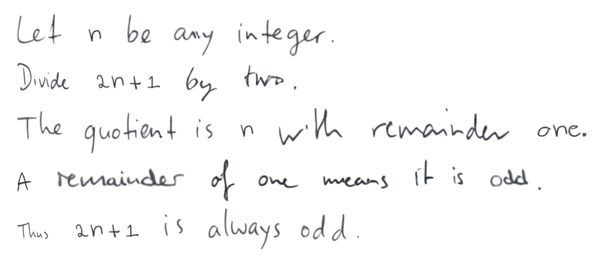
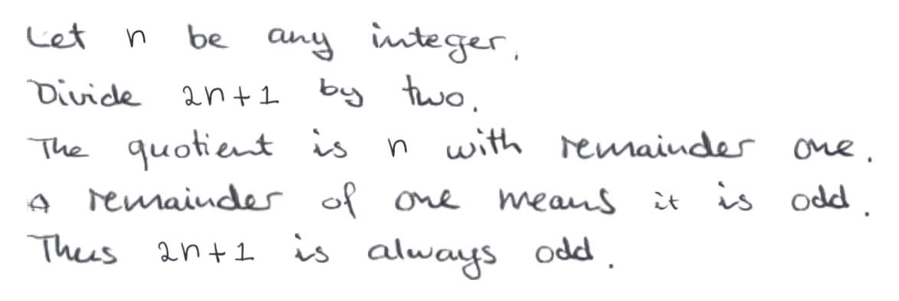

# Handgen

Can we adapt a handwriting model from a few transcribed lines, then write new text and math in the same hand? Handgen tunes a small style adapter for English prose, draws inline symbols from the writer’s worksheet, and renders user-chosen text as SVG and PNG.



DiffBrush [1] wrote phrases such as “by two.” Fitted VATr++ [2] wrote “remainder” and “odd.” on line four. The writer’s worksheet supplied the four math expressions and the letters for “one.” on line three. OCR read “quotient” as “quatient,” the only edit in 118 prose characters. [Typed proof](examples/odd_integer_proof.txt) · [Handwriting samples](docs/assets/odd-integer-sources.png) · [Run records](docs/results.json)

<details>
<summary>Same proof with all prose generated by fitted VATr++</summary>



VATr++ generated all 25 English word placements. The math came from the same worksheet. Page OCR counted two edits in 118 prose characters.

</details>

## How it works

**Enroll samples → fit a writer adapter → generate prose → compose math and pages → verify the export.**

| Stage | Engineering | Measured result |
| --- | --- | --- |
| Enroll | Deskew scans, align transcripts to word gaps, and extract labeled symbols from the worksheet. | Three lines yielded 26 word and punctuation crops. The worksheet yielded 92 usable labels, including on scans rotated up to 6° in either direction. |
| Fit | Freeze VATr++ and tune 512 style parameters. Select the checkpoint on held-out word types. | On five unseen words from a separate page, mean ink-shape loss fell 4.5%, from 0.4385 to 0.4188. |
| Generate | Size the DiffBrush canvas to each short phrase. Keep readable portions and fill gaps with sample ink or fitted VATr++ words. | Across 24 paired short-prompt runs, canvas sizing reduced OCR edits from 538 to 101 over 300 target characters. Extra generated letters count as insertions. |
| Compose | Align worksheet glyphs with prose, wrap lines, and record the source range and ink used for each placement. | A 72-line input with blank lines and repeated equations produced three SVG/PNG pages and preserved every source byte. |
| Verify | Read prose back from the exported PNG without giving the recognizer the target text. | On one 124-character note, OCR counted 16 edits for DiffBrush, 4 for base VATr++, 1 for fitted VATr++ and 0 for the combined route with a worksheet. |

[Experiment setup and results](docs/findings.md) · [Held-out word comparison](docs/assets/handgen-writer-fit.png) · [Architecture](docs/architecture.md)

## Limitations

- The study covers two writers. On the independent five-word test for one writer, three words improved and two regressed. The loss measures ink overlap and density. Perceived resemblance still needs blinded human ratings.
- DiffBrush can repeat or omit letters. Even a word that passes crop-level OCR can be misread on the finished page.
- Math supports inline notation covered by the worksheet or composed from its marks. The example sheet lacks lowercase γ. Stacked fractions and matrices need a two-dimensional layout.

## Try it with the bundled samples

Install Python 3.11 or newer and the SVG rasterizer (`brew install librsvg` on macOS, `librsvg2-bin` on Debian/Ubuntu). This CPU example rearranges nine words from a real handwritten pangram.

```bash
git clone https://github.com/navkul/handgen.git
cd handgen
python3 -m venv .venv
source .venv/bin/activate
python -m pip install -e '.[test]'
export HANDGEN_DATA_DIR="$PWD/outputs/catalog"

handgen init
handgen writer create writer_002
handgen style add writer_002 data/style_refs/writer_002/natural_prose_primary.png \
  --transcript examples/transcripts/writer_002_primary.txt
handgen document render writer_002 examples/recombined_prose.txt \
  --prose samples --require-verified --out outputs/words
```

Open `outputs/words/document.png`. For your own input, mark inline math with double brackets, as in `Choose [[x ≥ 0]].` Run `python -m pytest -q` for the test suite. [Pangram example](docs/assets/handgen-preview.png) · [CLI and file formats](docs/pipeline.md)

<details>
<summary>Reproduce the DiffBrush + VATr++ proof</summary>

In the same checkout and environment, install both model checkpoints and a local OCR reader. The reported run used an Apple M5 Pro. [Model setup and checksums](models/README.md)

```bash
handgen writer create writer_001
for ref in primary alt01 alt04; do
  handgen style add writer_001 "data/style_refs/writer_001/natural_prose_$ref.png" \
    --transcript "examples/transcripts/writer_001_$ref.txt"
done
handgen worksheet ingest writer_001 data/worksheets/writer_001/writer_001_worksheet_01.png
handgen style fit writer_001 --steps 100 --seed 732 --out outputs/fit \
  --test-reference data/style_refs/writer_001/natural_prose_alt03.png \
                   examples/transcripts/writer_001_holdout.txt
handgen eval render writer_001 --source examples/odd_integer_proof.txt \
  --prose auto --carriers --seed 732 --require-verified \
  --adapter outputs/fit/writer.safetensors --out outputs/odd-combined
```

Open `outputs/odd-combined/render/document.png` for the proof and `outputs/odd-combined/metrics.json` for the OCR readings and rendering methods.

</details>

## References

**[1]** G. Dai, Y. Zhang, Y. Qin, Q. Guo, S. Huang, and S. Yan, “Beyond Isolated Words: Diffusion Brush for Handwritten Text-Line Generation,” in *Proceedings of the IEEE/CVF International Conference on Computer Vision (ICCV)*, 2025, pp. 19054–19064. [doi:10.1109/ICCV51701.2025.01771](https://doi.org/10.1109/ICCV51701.2025.01771)

**[2]** B. Vanherle, V. Pippi, S. Cascianelli, N. Michiels, F. Van Reeth, and R. Cucchiara, “VATr++: Choose Your Words Wisely for Handwritten Text Generation,” *IEEE Transactions on Pattern Analysis and Machine Intelligence*, vol. 47, no. 2, pp. 934–948, Feb. 2025. [doi:10.1109/TPAMI.2024.3481154](https://doi.org/10.1109/TPAMI.2024.3481154)

<details>
<summary>BibTeX for LaTeX</summary>

```bibtex
@inproceedings{dai2025diffbrush,
  author    = {Dai, Gang and Zhang, Yifan and Qin, Yutao and Guo, Qiangya and Huang, Shuangping and Yan, Shuicheng},
  title     = {Beyond Isolated Words: {Diffusion Brush} for Handwritten Text-Line Generation},
  booktitle = {Proceedings of the IEEE/CVF International Conference on Computer Vision (ICCV)},
  year      = {2025},
  pages     = {19054--19064},
  doi       = {10.1109/ICCV51701.2025.01771}
}

@article{vanherle2025vatrpp,
  author  = {Vanherle, Bram and Pippi, Vittorio and Cascianelli, Silvia and Michiels, Nick and Van Reeth, Frank and Cucchiara, Rita},
  title   = {{VATr++}: Choose Your Words Wisely for Handwritten Text Generation},
  journal = {IEEE Transactions on Pattern Analysis and Machine Intelligence},
  year    = {2025},
  volume  = {47},
  number  = {2},
  pages   = {934--948},
  doi     = {10.1109/TPAMI.2024.3481154}
}
```

</details>

Arnav Kulkarni and Felix Tuchscherer are the co-authors of Handgen. The MIT license covers original Handgen code. Third-party code, fonts, weights and datasets retain their own terms. [MIT license](LICENSE) · [Upstream code, data and software credits](docs/references.md)
